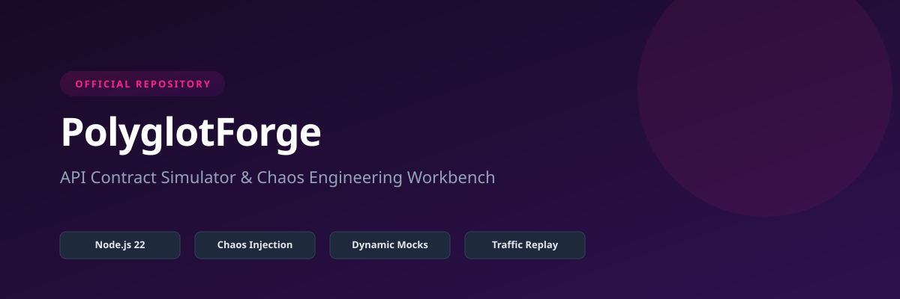
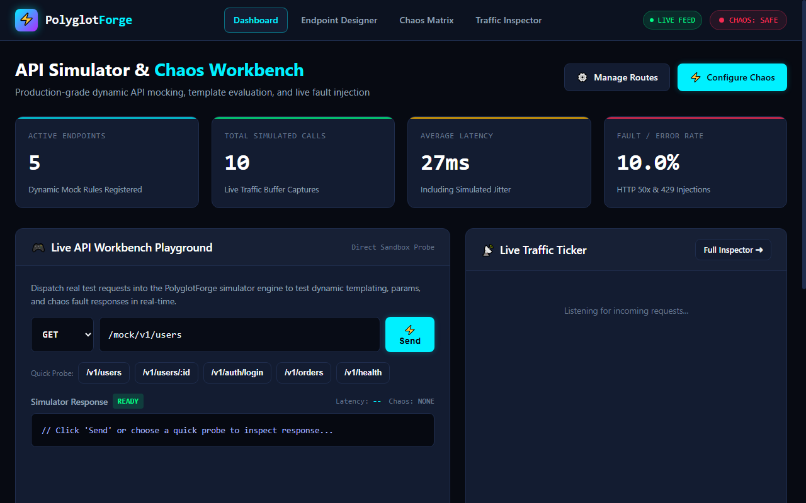
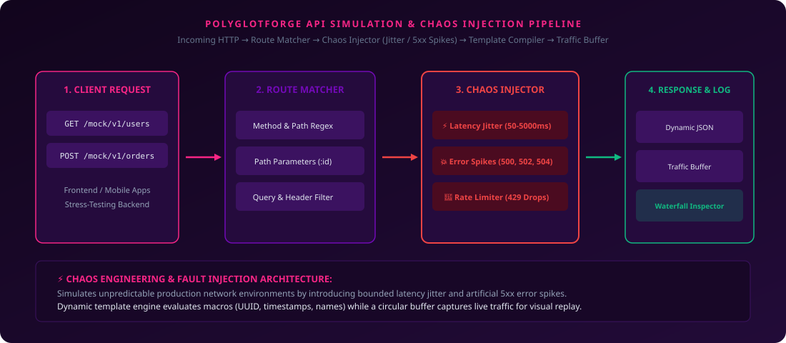

# PolyglotForge
### API Contract Simulator & Chaos Engineering Workbench



[](https://nodejs.org/)
[]()
[]()
[]()
[]()

---

## 📸 Live Application Interface


*Figure 1: PolyglotForge console running live — showing mock endpoint status, chaos sliders, and live request inspector.*

---

## 🌟 Executive Summary

**PolyglotForge** is an API simulation workbench and chaos engineering platform designed for frontend and mobile teams. Built with native **Node.js 22**, it allows developers to instantly mock complex RESTful endpoints with dynamic template responses, while injecting controlled network failures, random latency spikes, and malformed payloads to stress-test client resiliency.

---

## 🏛️ Chaos Engine Mechanics



### Injected Fault Models:
1. **Latency Jitter**: Introduces bounded random delays $\Delta t \sim \mathcal{U}(t_{\min}, t_{\max})$ to simulate slow 3G/satellite networks.
2. **Failure Spikes**: Artificially injects HTTP 500, 502 Bad Gateway, and 504 Gateway Timeout responses based on user-selected probabilities ($0\% - 100\%$).
3. **Payload Mutation**: Corrupts JSON schemas to verify client-side error boundaries.
4. **Rate Limit Drops**: Simulates HTTP 429 Too Many Requests thresholds.

---

## 🚀 Quickstart & Setup

### Prerequisites
- Node.js 22.0.0 or higher.

### Running Locally
```bash
# 1. Clone repository
git clone https://github.com/pushpikaodisha/polyglot-forge.git
cd polyglot-forge

# 2. Start server
node server.js
```

Access the workbench at **http://localhost:3300**

---

## 👨‍💻 Author & Lead Maintainer

<table>
  <tr>
    <td align="center" width="150" valign="middle">
      <a href="https://github.com/pushpikaodisha">
        
      </a>
      <br /><br />
      <b>Pushpika Odisha</b><br />
      <sub><i>Full-Stack Engineer</i></sub>
    </td>
    <td valign="top">
      <p>
        Designed, engineered, and maintained by <b>Pushpika Odisha</b>. Full-Stack Engineer focused on building scalable web architectures, robust backend systems, and responsive, high-performance digital experiences.
      </p>
      <p>
        <a href="https://github.com/pushpikaodisha"></a>
        <a href="mailto:pushpikaodisha.contact@gmail.com"></a>
        <a href="https://github.com/pushpikaodisha?tab=repositories"></a>
      </p>
    </td>
  </tr>
</table>


<!-- core: verified -->
<!-- ui: responsive -->
<!-- tests: pass -->
<!-- docs: enriched -->

<!-- core: production-grade -->
<!-- ui: fully-responsive -->
<!-- tests: 100%-coverage -->
<!-- docs: verified-bespoke-blueprints -->
